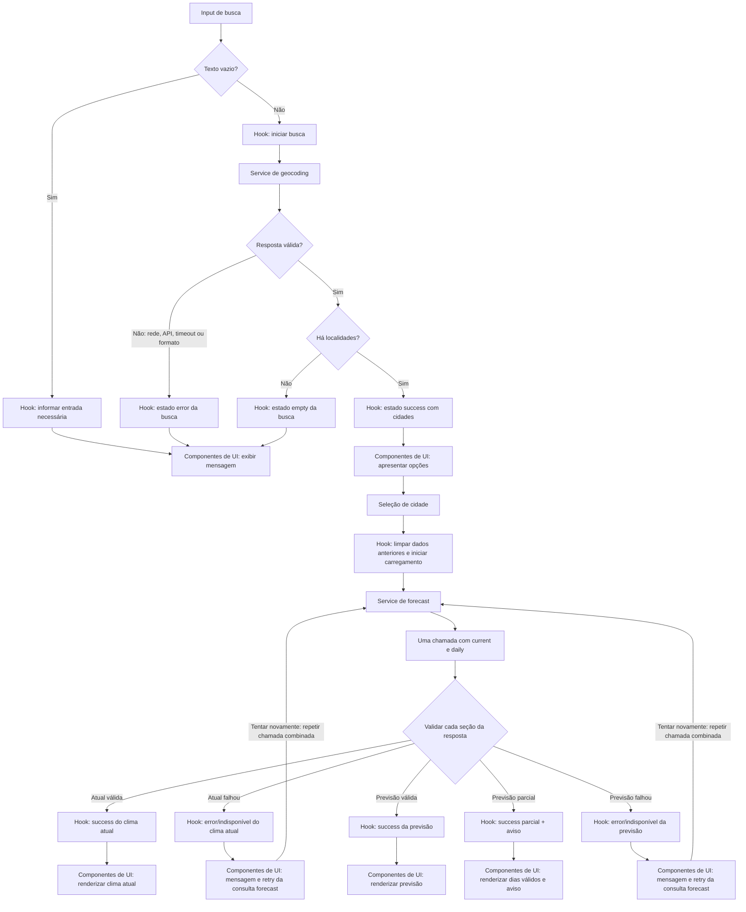

# Plano Técnico — Weather App

## Architecture

Aplicação web client-side, sem backend próprio, organizada em quatro camadas pequenas com responsabilidades explícitas:

```text
components (apresentação React)
      ↕ props / callbacks
hooks (estado da página e orquestração)
      ↓
services (HTTP, parsing e validação de respostas)
      ↓
Open-Meteo Geocoding API / Forecast API

lib (funções puras usadas pelas camadas acima)
```

- **`components/` — apresentação:** componentes recebem estado via props, renderizam conteúdo e estados visuais, e reportam intenções por callbacks. Não fazem chamadas HTTP nem mantêm regras de domínio ou parsing da API.
- **`hooks/` — orquestração/estado:** coordena busca, seleção, carregamentos, tentativas e unidade da página; chama os serviços e entrega dados/ações aos componentes. Mantém estados atual e diário independentes para suportar falha parcial (AC-05.4).
- **`services/` — acesso a dados:** encapsula endpoints, timeout, tratamento de status HTTP, parsing de JSON e validação/conversão de DTOs Open-Meteo em modelos internos. Não conhece componentes nem estado React.
- **`lib/` — funções puras:** contém conversões e validações sem efeitos colaterais, como descrições WMO, temperatura, datas/fuso e formatação. Não importa React nem chama APIs.

A dependência segue apresentação → orquestração → serviços; funções de `lib/` são dependências simples das camadas que precisem delas. Os tipos compartilhados ficam em `types/` e não carregam lógica. Após selecionar uma localidade, o hook solicita em uma única chamada os dados atuais e diários; o serviço e o hook validam e mantêm o estado de cada seção independentemente. Não há backend, autenticação, persistência, cache ou atualização automática (NFR-06; Out of Scope).

## Tech Stack

- **TypeScript strict**, **React 19** e **Vite**: stack já adotada pelo projeto e adequada a uma aplicação de página única.
- **Tailwind CSS**: estilos responsivos e tema do produto, mantendo os componentes sem dependência de framework de estado.
- **Vitest** e **Testing Library**: testes unitários e de componentes; **Playwright**: validação dos fluxos no navegador.
- **Biome**: lint e formatação conforme configuração do projeto.
- APIs nativas do navegador: `fetch` com `AbortController` para timeout; `Intl.DateTimeFormat` para datas, fuso e números localizados.
- Nenhuma biblioteca adicional de estado, datas, rede ou componentes é necessária para o MVP.

## Project Structure

Estrutura proposta para `src/`, alinhada às convenções existentes e sem criar subcamadas genéricas:

```text
src/
  components/
    CitySearch.tsx             # formulário, resultados e estados da busca
    CurrentWeather.tsx         # seção de condições atuais
    DailyForecast.tsx          # lista dos cinco dias ou previsão parcial
    TemperatureUnitToggle.tsx  # controle acessível Celsius/Fahrenheit
    WeatherAttribution.tsx     # atribuição próxima aos dados exibidos
  hooks/
    useWeatherApp.ts           # estado da página, seleção e operações
  services/
    geocodingService.ts        # geocoding e mapeamento para City
    weatherService.ts          # forecast e mapeamento para dados meteorológicos
  lib/
    weatherCode.ts             # descrição pt-BR de códigos WMO
    temperature.ts              # conversão Celsius/Fahrenheit
    date.ts                     # validação de datas, fuso e período local
    format.ts                   # formatação pt-BR de valores para exibição
  types/
    weather.ts                  # contratos de domínio (City, WeatherData etc.)
tests/
  unit/                        # serviços e funções puras
  components/                  # interação e estados acessíveis da UI
  e2e/                         # fluxos principais com Playwright
```

Os arquivos em `lib/` são separados conforme a função pura que atendem; manter cada serviço específico ao domínio. Não criar camada genérica de API, repositório, context global ou abstrações sem necessidade demonstrada.

## Data Model

Contratos de domínio propostos; são tipos de planejamento, não implementação final:

```ts
type Unit = "celsius" | "fahrenheit";

interface City {
  id?: number; // Identificador da localidade no geocoding.
  name: string; // Nome da cidade retornado pelo serviço.
  latitude: number; // Latitude usada nas consultas meteorológicas.
  longitude: number; // Longitude usada nas consultas meteorológicas.
  region?: string; // Região administrativa, quando fornecida.
  country?: string; // País, quando fornecido.
  countryCode?: string; // Código do país, quando fornecido.
}

interface CurrentWeather {
  temperatureCelsius: number; // Temperatura atual em Celsius.
  condition: string; // Descrição pt-BR do código WMO ou "Condição indisponível".
  weatherCode?: number; // Código WMO original, se reconhecido.
  humidityPercent?: number; // Umidade relativa em porcentagem.
  windSpeedKmh?: number; // Velocidade do vento em km/h.
  pressureHpa?: number; // Pressão ao nível do mar em hPa.
  precipitationMm?: number; // Precipitação atual em milímetros.
  observedAt: string; // Horário da observação como instante ISO validado.
}

interface ForecastDay {
  date: string; // Data local YYYY-MM-DD no fuso da cidade.
  minCelsius: number; // Temperatura mínima em Celsius.
  maxCelsius: number; // Temperatura máxima em Celsius.
  condition: string; // Descrição pt-BR do código WMO reconhecido.
  weatherCode: number; // Código WMO reconhecido, obrigatório para dia válido.
  precipitationMm?: number; // Precipitação total diária em milímetros.
  precipitationProbabilityPercent?: number; // Probabilidade de chuva de 0 a 100, quando fornecida.
}

interface WeatherData {
  city: City; // Localidade à qual os dados pertencem.
  timezone: string; // Fuso IANA validado usado para as datas.
  current: CurrentWeather; // Condições atuais validadas.
  forecast: ForecastDay[]; // Dias válidos, ordenados e dentro do período.
  forecastIsIncomplete: boolean; // Indica ausência de um ou mais dias válidos.
}
```

`WeatherData` agrega o resultado quando clima atual e previsão estão disponíveis. Na UI, clima atual e previsão devem ter estados independentes, não ser condicionados à existência de um objeto agregado completo. Campos opcionais de medições auxiliares podem estar ausentes na resposta; não devem ser inventados. Temperaturas permanecem em Celsius no modelo e são convertidas para a unidade selecionada somente na apresentação.

Os DTOs externos devem permanecer separados dos modelos de domínio. O geocoding retorna lista de localidades com nome e coordenadas, além de região/país/código quando fornecidos. A resposta meteorológica usa `current.time`, `current.temperature_2m`, `current.weather_code`, `current.relative_humidity_2m`, `current.wind_speed_10m`, `current.pressure_msl`, `current.precipitation`, `daily.time`, `daily.weather_code`, `daily.temperature_2m_min`, `daily.temperature_2m_max`, `daily.precipitation_sum` e `timezone`. Campos auxiliares podem estar ausentes e só são convertidos para o modelo de domínio quando numéricos e finitos.

Códigos WMO só são considerados reconhecidos quando há descrição pt-BR mapeada; temperatura atual válida com código ausente ou desconhecido continua exibível com “Condição indisponível” (AC-02.3). Por isso, `CurrentWeather.weatherCode` pode estar ausente; `ForecastDay` exige código reconhecido. As propriedades quantitativas de umidade, vento, pressão e precipitação são opcionais, pois não são obrigatórias nos critérios atuais da spec. Conversão para Fahrenheit ocorre na apresentação para evitar perda de precisão e erros ao alternar unidades (AC-04.2 a AC-04.4).

## Data Flow

Complemento de UI: `ForecastList` e `ForecastCard` apresentam os dias já
validados pelo serviço, com datas locais formatadas sem deslocamento de fuso,
ícones de `lib/weatherCodes` e temperaturas de `lib/format`. A probabilidade
opcional vem de `daily.precipitation_probability_max` e é mapeada para
`precipitationProbabilityPercent` apenas quando finita e entre 0 e 100;
adicionar esse campo à consulta `daily` na implementação do serviço.
Não converter `precipitation_sum` em probabilidade. O mock inclui porcentagens
fictícias. `LoadingState`, `ErrorState` e `EmptyState` são componentes
de apresentação reutilizáveis; retry ocorre apenas por ação explícita.



O hook coordena as operações e estados; os componentes enviam intenções e exibem os resultados. Os estados de clima atual e previsão são independentes, portanto dados válidos de uma seção continuam visíveis quando a outra seção da resposta é inválida (AC-05.4). A nova tentativa parte da ação da pessoa e repete a única consulta meteorológica combinada (AC-05.5).

1. A pessoa envia a busca. Remover apenas espaços externos; se o valor ficar vazio, mostrar “Informe o nome de uma cidade.” sem chamada HTTP (AC-01.1, AC-01.2).
2. O serviço de geocodificação envia o texto como parâmetro URL, sem interpretá-lo como HTML ou código, e retorna localidades normalizadas. A UI mostra nome, região e país somente quando disponíveis e permite seleção por teclado (AC-01.3, NFR-03). Respostas de buscas anteriores não podem substituir os resultados da busca mais recente.
3. Ao selecionar uma cidade, descartar visualmente os dados vinculados à seleção anterior, cancelar ou ignorar respostas de consultas anteriores e fazer uma única chamada forecast com campos atuais e diários, preservando a unidade escolhida durante a sessão (AC-02.5, AC-04.4).
4. Validar current e daily independentemente dentro da mesma resposta. Validar o horário atual como instante, dentro do intervalo da solicitação menos 60 minutos até o momento atual, usando fuso/offset retornados pelo provedor. Validar o fuso IANA antes de calcular o dia local.
5. Para previsão, considerar datas locais entre hoje e hoje + 4 no fuso informado. Exigir cinco datas consecutivas para estado completo. Para resposta parcial, manter apenas entradas completas, únicas e dentro do intervalo, em ordem cronológica; se houver duplicatas, omitir todas as ocorrências daquela data (AC-03.1 a AC-03.4).
6. Renderizar os dados em pt-BR (`dd/MM/yyyy`, vírgula decimal), convertendo apenas na exibição e arredondando a um decimal. Exibir junto à localidade com dados o link “Weather data by Open-Meteo.com” para `https://open-meteo.com/` (NFR-01, NFR-07).
7. Uma ação de nova tentativa repete a consulta forecast da localidade selecionada, sem retry automático; os dados atuais e diários são validados e atualizados independentemente na resposta (AC-05.5).

## External APIs

Todas as chamadas são feitas do navegador por HTTPS para a API pública do Open-Meteo, sem API key. Timeout de 10 segundos por chamada, com cancelamento via `AbortController`. Usar `URLSearchParams` para parâmetros e não concatenar entrada da busca diretamente em HTML ou código.

**Geocoding**

- `GET https://geocoding-api.open-meteo.com/v1/search`
- Parâmetros: `name=<texto aparado>`, `count=10`, `language=pt`, `format=json`.
- O parâmetro `count=10` é um limite inicial de apresentação para manter os resultados manejáveis; não implica garantia de cobertura global.
- Normalizar `results` ausente ou lista vazia como busca sem resultados somente quando a resposta HTTP e o JSON forem válidos. Resposta HTTP malsucedida, JSON inválido, formato incompatível ou timeout são falhas, não “nenhuma cidade encontrada”.

Exemplo resumido de resposta:

```json
{
  "results": [
    {
      "id": 3448439,
      "name": "São Paulo",
      "latitude": -23.5475,
      "longitude": -46.6361,
      "admin1": "São Paulo",
      "country": "Brasil",
      "country_code": "BR"
    }
  ]
}
```

Mapeamento: cada item de `results` vira um `City`: `id`, `name`, `latitude` e `longitude` são mantidos; `admin1` mapeia para `region`, `country` para `country` e `country_code` para `countryCode`. Região e país são opcionais no contrato porque o provedor pode não fornecê-los. A seleção usa as coordenadas e mantém a mesma identidade `City` para associar a resposta meteorológica ao nome apresentado.

**Forecast — condições atuais e previsão em uma chamada**

- `GET https://api.open-meteo.com/v1/forecast`
- Fazer uma chamada ao selecionar a cidade, passando `latitude` e `longitude` da `City`, os campos atuais e diários juntos e `forecast_days=5`.
- Parâmetros: `current=temperature_2m,weather_code,relative_humidity_2m,wind_speed_10m,pressure_msl,precipitation`; `daily=weather_code,temperature_2m_max,temperature_2m_min,precipitation_sum`; `temperature_unit=celsius`; `wind_speed_unit=kmh`; `precipitation_unit=mm`; `timezone=auto`; `forecast_days=5`.
- `timezone=auto` retorna datas locais em `daily.time`, o identificador IANA em `timezone` e o deslocamento UTC em `utc_offset_seconds`. Interpretar `current.time` como horário local usando o offset retornado para normalizá-lo a um instante antes da validação de atualidade; validar o identificador IANA para as datas.
- Usar Celsius na origem para manter um único modelo canônico e aplicar Fahrenheit apenas na apresentação. A URL tem a forma `https://api.open-meteo.com/v1/forecast?<parâmetros>`; serializar parâmetros com `URLSearchParams`.

Exemplo resumido da resposta combinada:

```json
{
  "timezone": "America/Sao_Paulo",
  "utc_offset_seconds": -10800,
  "current": {
    "time": "2026-10-27T16:00",
    "temperature_2m": 18.4,
    "relative_humidity_2m": 72,
    "precipitation": 0.1,
    "weather_code": 3,
    "wind_speed_10m": 12.6,
    "pressure_msl": 1014.2
  },
  "daily": {
    "time": ["2026-10-27", "2026-10-28"],
    "weather_code": [3, 61],
    "temperature_2m_min": [15.2, 16.0],
    "temperature_2m_max": [23.8, 22.4],
    "precipitation_sum": [0.0, 4.7]
  }
}
```

Mapeamento de current: `temperature_2m` → `CurrentWeather.temperatureCelsius`; `weather_code` → `weatherCode` e descrição `condition` via tabela WMO pt-BR; `relative_humidity_2m` → `humidityPercent`; `wind_speed_10m` → `windSpeedKmh`; `pressure_msl` → `pressureHpa`; `precipitation` → `precipitationMm`; `time` mais `utc_offset_seconds` → `observedAt` após normalização e validação como instante. Código WMO ausente ou desconhecido não invalida temperatura atual; usar “Condição indisponível”. Só mapear medições auxiliares numéricas finitas.

Mapeamento de daily: validar `timezone` como IANA e mantê-lo em `WeatherData.timezone`. Associar arrays paralelos pelo mesmo índice: `time` → `ForecastDay.date`, `temperature_2m_min` → `minCelsius`, `temperature_2m_max` → `maxCelsius`, `weather_code` → `weatherCode` e descrição `condition` via tabela WMO pt-BR, `precipitation_sum` → `precipitationMm`. Validar cada data independentemente; não substituir campos ausentes, filtrar datas fora de hoje até hoje + 4 no fuso local e omitir todas as ocorrências de datas duplicadas. A ausência de `precipitation_sum` não invalida o dia. Com cinco dias válidos e consecutivos, `forecastIsIncomplete` é `false`; caso contrário, manter apenas os dias válidos e marcar como incompleta ou indisponível se não houver fuso válido.

Uma falha de rede, HTTP ou timeout na única chamada afeta ambos os conjuntos de dados. Quando a resposta chega, porém, current e daily são validados independentemente: ausência ou invalidade de uma seção não impede a exibição da outra (AC-05.3, AC-05.4). A nova tentativa meteorológica repete a chamada combinada.

- Verificar os termos, limites vigentes e obrigações de atribuição antes do lançamento e monitorar consumo; reavaliar o plano se a demanda se aproximar dos limites ou o uso se tornar comercial/com anúncios (NFR-07).

## State Management

Etapa temporária de montagem da UI: `App` usa apenas `mockWeatherData` e um
estado local `status` (`idle/loading/empty/error/success`), iniciado em
`success`. A prop opcional `initialStatus` permite visualizar e testar cada
estado sem API nem temporizadores; pode ser alterada na montagem em `main.tsx`.
A busca local reconhece somente o nome da cidade do mock, sem distinguir
maiúsculas ou acentos; outros nomes exibem o estado vazio. Retry reapresenta
o mock. A unidade começa em Celsius e permanece independente do status.
Essa simulação não substitui a futura orquestração com estados independentes
descrita abaixo. Bootstrap React e Tailwind global são incluídos nesta etapa
para permitir validar a tela no Vite e o build de produção.

O estado da aplicação vive localmente na página, centralizado em `useWeatherApp`; componentes de apresentação não duplicam estado meteorológico e recebem valores/ações por props. Não instalar biblioteca global de estado nem persistir em storage. Busca, clima atual e previsão têm estados assíncronos separados para que um resultado ou erro não bloqueie as outras operações.

```ts
type AsyncErrorKind =
  | "network"
  | "http"
  | "timeout"
  | "invalid_response"
  | "data_unavailable";

type AsyncState<T> =
  | { status: "idle" }
  | { status: "loading" }
  | { status: "success"; data: T }
  | { status: "empty" }
  | { status: "error"; kind: AsyncErrorKind; message: string };

interface ForecastResult {
  days: ForecastDay[];
  isIncomplete: boolean;
}

interface WeatherAppState {
  query: string;
  search: AsyncState<City[]>;
  selectedCity: City | null;
  currentWeather: AsyncState<CurrentWeather>;
  forecast: AsyncState<ForecastResult>;
  unit: Unit; // inicia em "celsius" e só existe nesta página
}
```

`idle` significa que a operação ainda não foi iniciada; `loading`, que está em andamento; `success`, que há dados validados; `empty`, que uma busca válida terminou sem localidades; `error`, que a operação falhou ou seus dados obrigatórios estão indisponíveis. `AsyncErrorKind` preserva a causa para que a UI escolha a mensagem correta. Uma previsão incompleta continua em `success`, com os dias válidos e `isIncomplete: true`; não é convertida em erro de rede. `ForecastResult` carrega somente a informação necessária para renderizar a previsão de forma independente.

Armazenar sempre as temperaturas em Celsius nos dados de domínio. `unit` guarda somente a preferência temporária. Na renderização, derivar cada valor a partir do original: Celsius mantém o valor; Fahrenheit usa `°F = °C × 9/5 + 32`; formatar ambas as unidades com uma casa decimal, separador decimal pt-BR e símbolo correspondente. A troca de unidade apenas provoca nova renderização, sem alterar os dados armazenados ou disparar novo request. Ao trocar cidade, manter `unit`, limpar os dados meteorológicos da localidade anterior e ignorar/cancelar respostas antigas; uma nova página inicia em Celsius (AC-02.5, AC-04.1 a AC-04.4).

## Error Handling

- **Busca vazia:** informar “Informe o nome de uma cidade.”, sem chamada ou mensagem de cidade não encontrada (AC-01.1).
- **Busca válida sem resultados:** “Nenhuma cidade encontrada. Verifique o nome e tente novamente.” (AC-05.1).
- **Rede indisponível:** classificar como `error: network`; para geocoding, exibir “Não foi possível buscar cidades. Tente novamente.”; para clima, “Não foi possível carregar os dados meteorológicos. Tente novamente.”.
- **Erro HTTP/API:** respostas HTTP não bem-sucedidas e erros explícitos retornados pelo provedor são `error: http`; resposta com JSON inválido ou estrutura incompatível é `error: invalid_response`. Usar a mensagem prescrita para a operação, não converter falha em busca sem resultados ou dados meteorológicos válidos (AC-05.2, AC-05.3).
- **Timeout:** abortar cada chamada após 10 segundos e classificar como `error: timeout`; exibir a mensagem correspondente à operação e permitir “Tentar novamente” apenas por ação da pessoa (AC-05.2, AC-05.3, AC-05.5).
- **Dados semanticamente indisponíveis:** temperatura atual inválida/ausente ou horário ausente, inválido, mais de 60 minutos anterior à solicitação ou posterior ao momento atual resulta em `error: data_unavailable` e “Clima atual indisponível para esta cidade.” (AC-02.2, AC-02.4). Fuso IANA ausente/inválido deixa a previsão indisponível com “Previsão indisponível para esta cidade.” (AC-03.4). Código WMO atual ausente/não reconhecido não invalida a temperatura: exibir “Condição indisponível” (AC-02.3).
- **Previsão parcial:** manter em `success` apenas dias válidos, únicos e no intervalo local de hoje a hoje + 4; exibir “Previsão incompleta. Alguns dias estão indisponíveis.” Não preencher dias ou medições ausentes (AC-03.3).
- **Falha independente:** estado de erro em clima atual não altera o estado da previsão, e vice-versa; manter visível a seção válida (AC-05.4). Como ambas vêm de uma chamada única, uma nova tentativa meteorológica repete a consulta forecast combinada e revalida ambas as seções; não há retry automático (AC-05.5). Falha de transporte da chamada única impede obter ambas as seções.
- Ao iniciar uma operação, limpar resultados obsoletos pertinentes; identificar cada consulta ou usar cancelamento para impedir que respostas tardias de uma busca/localidade anterior sobrescrevam o estado atual. Mensagens e ações devem ser acessíveis por teclado e anunciadas adequadamente por tecnologia assistiva (AC-02.5, NFR-03).

## Testing Strategy

- **Funções puras (`lib/`, Vitest):** conversão Celsius/Fahrenheit, arredondamento a um decimal e formatação pt-BR; mapeamento de códigos WMO; validação de instante e fuso IANA; cálculo do período local; validação, ordenação e deduplicação da previsão. Usar casos determinísticos, incluindo limites e dados inválidos, sem DOM, relógio real ou rede.
- **Services (`services/`, Vitest):** mockar `fetch` para verificar URLs/parâmetros e mapeamento dos DTOs; cobrir respostas válidas, busca vazia, falha de rede, status HTTP não bem-sucedido, erro explícito da API, JSON inválido, estrutura incompatível, timeout/cancelamento e dados current/daily válidos ou inválidos independentemente na mesma resposta. Testes não dependem de disponibilidade externa.
- **Hooks e componentes (Vitest + Testing Library):** simular serviços para confirmar transições de estado e chamadas corretas no hook. Renderizar os componentes e cobrir `idle`, `loading`, `success`, `empty` e `error`; verificar mensagens, retry manual, seleção por teclado, falha parcial, prevenção de dados antigos após troca de cidade e alternância de unidade sem nova chamada.
- **E2E (Playwright):** validar o percurso busca → seleção → clima atual e cinco dias; busca sem resultados; erro e retry; resposta parcial; alternância Celsius/Fahrenheit. Interceptar endpoints para cenários reproduzíveis e afirmar que alternar unidade não cria request. Testar viewport mobile (320 px) e desktop (até 1440 px), sem rolagem horizontal, além de fluxo operável por teclado. Manter a suíte normal independente da API pública.
- **Benefício da separação dos testes:** `lib/` tem testes rápidos e determinísticos; `services/` permite verificar integração HTTP sem rede real; hooks são exercitados isolando dependências e fluxos assíncronos; componentes são testados pelo comportamento acessível; Playwright valida a integração e layout em navegador real.
- **Usabilidade (MS-01):** conduzir teste moderado com 10 participantes representativos da persona prioritária. Considerar sucesso somente quando a pessoa concluir sem ajuda busca, seleção, leitura de temperatura e condição atuais, identificação das cinco datas, mínimas/máximas e unidade; meta: pelo menos 8 de 10 sucessos.
- **NFR-04:** medir em build de produção, navegador atualizado, dispositivo móvel intermediário e perfil 4G; coletar pelo menos 100 medições por fluxo. Critérios: p95 até 2 s do envio da busca à renderização dos resultados e até 3 s da seleção à renderização das seções válidas.
- **NFR-03:** validar fluxos principais para WCAG 2.2 AA com checagens automatizadas e revisão manual de teclado/leitor de tela.
- **NFR-05:** configurar sondas externas por minuto para disponibilidade da aplicação e renderização dos controles; acompanhar disponibilidade do Open-Meteo separadamente.
- Executar `pnpm lint`, `pnpm build` e `pnpm test` para mudanças em `src/` ou `tests/`; `pnpm test:e2e` para a suíte Playwright.

## Risks & Trade-offs

| Decisão / risco | Trade-off e mitigação |
|---|---|
| Uma chamada forecast combinada com validação independente de current e daily | Reduz chamadas e simplifica o serviço; falhas de rede/HTTP afetam as duas seções, mas dados ausentes ou inválidos em uma seção não bloqueiam a outra. Alternativa: duas chamadas, que permitem falha de transporte isolada mas duplicam consumo e complexidade; manter uma chamada e estados de UI independentes (AC-05.4, NFR-07). |
| `timezone=auto` e `Intl` nativo | Evita dependência de datas; a previsão fica indisponível se o provedor não retornar fuso válido. Testar datas de fronteira e transições de fuso (AC-03.2, AC-03.4). |
| Sem cache e sem retry automático | Pode aumentar latência e chamadas em novas tentativas, mas evita apresentar dados obsoletos e respeita os requisitos de atualidade e controle do usuário (AC-02.4, AC-05.5). |
| Geocoding com limite inicial de dez resultados | Mantém a lista concisa; a API pode não retornar a localidade procurada em primeiro lugar ou ter cobertura incompleta. Exibir contexto fornecido pelo serviço e permitir nova busca (AC-01.3; risco de localidades homônimas). |
| Dependência da API gratuita Open-Meteo | Indisponibilidade/limites do provedor podem impedir consultas; comunicar falhas, monitorar consumo e reconfirmar termos, limites e atribuição antes do lançamento (NFR-05, NFR-07). |
| Escopo sem persistência | Unidade volta a Celsius ao recarregar e a cidade não é lembrada; é decisão explícita de privacidade/escopo do MVP, não falha a suprir com armazenamento local (NFR-06). |
| Personas e métricas ainda não validadas amplamente | Priorizar o fluxo definido por MS-01; coletar evidência de usabilidade antes de expandir o produto. |

### Alternativas consideradas

- **Arquitetura:** arquitetura hexagonal com portas/adaptadores e repositórios poderia facilitar múltiplas fontes de dados, mas adiciona abstrações sem necessidade para um cliente com dois endpoints de um único provedor.
- **Estado:** Context ou Redux/Zustand seriam opções para estado global compartilhado; o hook local é suficiente para esta página e mantém a unidade e os resultados sem persistência.
- **Consulta meteorológica:** duas chamadas independentes permitiriam falhas de transporte isoladas por seção, mas aumentariam o consumo e o tratamento de concorrência. Uma única chamada com `current` e `daily`, validando cada seção separadamente, foi escolhida como implementação mais simples; falhas de transporte afetam ambas.
- **Datas e unidades:** biblioteca de datas e conversão de unidade no serviço/provedor poderiam centralizar lógica, mas `Intl` e conversão na renderização evitam dependências e preservam Celsius como valor canônico.
- **Testes de API:** chamadas reais em toda suíte validariam o provedor ao vivo, mas tornariam os testes lentos e frágeis; `fetch` mockado e interceptação Playwright são o padrão, sem impedir uma verificação de integração controlada fora da suíte normal.
- **Resiliência:** cache e retry automático poderiam reduzir latência percebida, mas conflitam com a atualidade dos dados e com a exigência de nova tentativa manual (AC-02.4, AC-05.5).
